# ⚡ WattWise: Publication-Grade System Architecture & Workflow Specifications

> **Tools & Platforms for Data Science 3 (TPDS 3 Capstone Project)**  
> **Regulatory Citations:** Maharashtra Electricity Regulatory Commission (MERC Case No. 226 of 2022)  
> **Target Utility:** Maharashtra State Electricity Distribution Co. Ltd. (MSEDCL / Mahavitaran LT-I Residential)  
> **Empirical Datasets:** Kaggle SGCC Smart Grid Electricity Theft (42,372 meters) • UCI Household Electricity (2.07M measurements)  
> **Lead Technical Review:** Verified 100% compliant with MERC tariff rules, TPDS 3 syllabus, and standard Mermaid renderers.

---

## 1. System Architecture Diagram (Four-Module Interlock)

This diagram details the four core modules of TPDS 3 organized in a 2-Tier presentation and platform layout:
- **Tier 1 (Presentation & Executive Analytics):**
  - **Module 2 (Frontend & 3D Visualization Layer):** Next.js 16 / React 19 UI, GSAP scroll timelines, Recharts, and Three.js SimReady 3D House digital twin.
  - **Module 1 (Power BI Desktop & Analytics Layer):** Tabular Star Schema, DAX measure engine, and executive analytical dashboards.
- **Tier 2 (Platform Services, Persistence & DevOps Infrastructure):**
  - **Module 3 (Backend & Relational Database Layer):** Node.js / Express REST & WebSocket API, MySQL 8.0 3NF normalized schema, stored procedures, analytical CTE views, and deterministic MERC tariff engine.
  - **Module 4 (DevOps, Data Ingest & CI/CD Pipeline):** Multi-stage Docker containerization, GitHub Actions CI/CD with MySQL service containers, MQTT Mosquitto broker, and automated Python batch ingestion for real-world benchmark datasets.

```mermaid
flowchart TB
%% =========================================================================
%% WATTWISE SYSTEM ARCHITECTURE (FOUR-MODULE INTERLOCK SPECIFICATION)
%% =========================================================================

  subgraph Presentation ["TIER 1: USER INTERACTION & EXECUTIVE ANALYTICS"]
    subgraph M2 ["MODULE 2: Frontend & SimReady 3D Virtual House"]
      direction TB
      subgraph M2_Web ["Next.js 16 / React 19 Client Web Application"]
        M2_Screens["Responsive Dashboard & PWA Views<br/>(Bill Checker, What-If Lab, Reality Check, Admin)"]:::m2
        M2_GSAP["GSAP Scroll & Transition Engine<br/>(Smooth Camera Morphs & Interactive Timelines)"]:::m2
        M2_Recharts["Recharts Analytical Suite<br/>(Live Slab Gauges, +118% Cliff, Daily Trends)"]:::m2
        M2_Split["Multi-Tenant Room Split Controller<br/>(Fair PG Roommate Cost & Runtime Allocator)"]:::m2
      end

      subgraph M2_Three ["Three.js SimReady 3D Virtual House"]
        M2_Canvas["Three.js Digital Twin Canvas<br/>(@react-three/fiber & @react-three/drei)"]:::m2_3d
        M2_Catalog["SimReady GLTF Appliance Catalog<br/>(Procedural Mesh, Active Watt Glow & Animations)"]:::m2_3d
        M2_Heatmap["Spatial Thermal & Power Density Overlay<br/>(Room-by-Room Dynamic Energetic Footprint)"]:::m2_3d
      end

      M2_Screens <--> M2_GSAP
      M2_Screens <--> M2_Recharts
      M2_Screens <--> M2_Split
      M2_Screens <--> M2_Canvas
      M2_Canvas --> M2_Catalog
      M2_Canvas --> M2_Heatmap
    end

    subgraph M1 ["MODULE 1: Power BI Desktop & Analytics Layer"]
      direction TB
      subgraph M1_Star ["Tabular Star Schema Warehouse"]
        M1_FactBill["Fact_MonthlyBilling<br/>(Billed vs Recomputed Units, Surcharges, Flags)"]:::m1
        M1_FactApp["Fact_ApplianceBreakdown<br/>(Monthly kWh, % Share, Carbon Footprint, BLDC ROI)"]:::m1
        M1_FactDaily["Fact_DailyReadings<br/>(Daily kWh, Ambient Temp, Z-Scores, Anomaly Flags)"]:::m1
        M1_FactTheft["Fact_GridTheftBenchmark<br/>(Kaggle SGCC Honest vs Tampered Bypassed Meters)"]:::m1
        M1_Dims["Dimension Tables<br/>Dim_Household, Dim_Date, Dim_TariffSlabs, Dim_ApplianceCatalog"]:::m1
      end

      subgraph M1_DAX ["DAX Analytical Measures Engine"]
        M1_Measures["Calculated DAX Measures<br/>Total kWh, Rupee Variance, Discrepancy %, Payback Months"]:::m1
      end

      subgraph M1_Dashboard ["Executive Presentation Dashboards"]
        M1_VisCliff["MSEDCL LT-I Slab Cliff Visualizer<br/>(+118% Marginal Rate Spike Analysis)"]:::m1
        M1_VisAudit["MERC Regulatory Audit Scatter Matrix<br/>(31.9% Error Detection & Net Overcharges)"]:::m1
        M1_VisVampire["Appliance Vampire Energy Pareto Chart<br/>(BLDC Fan & Inverter AC Payback Curve)"]:::m1
        M1_VisTheft["SGCC Smart Grid Theft Analysis<br/>(94.2% Non-Technical Loss Detection)"]:::m1
      end

      M1_Dims --> M1_FactBill
      M1_Dims --> M1_FactApp
      M1_Dims --> M1_FactDaily
      M1_Dims --> M1_FactTheft
      M1_FactBill --> M1_Measures
      M1_FactApp --> M1_Measures
      M1_FactDaily --> M1_Measures
      M1_FactTheft --> M1_Measures
      M1_Measures --> M1_VisCliff
      M1_Measures --> M1_VisAudit
      M1_Measures --> M1_VisVampire
      M1_Measures --> M1_VisTheft
    end
  end

  subgraph Platform ["TIER 2: CORE SERVICES, PERSISTENCE & DEVOPS INFRASTRUCTURE"]
    subgraph M3 ["MODULE 3: Backend & Relational Database Layer"]
      direction TB
      subgraph M3_API ["Node.js & Express REST / WebSocket API Service"]
        M3_Router["Express API Gateway & Auth<br/>(REST Endpoints /api/v1 & JWT Authentication)"]:::m3
        M3_Tariff["Deterministic Tariff Engine<br/>(MSEDCL LT-I, MERC Case No. 226 of 2022)"]:::core
        M3_Audit["Statutory Bill Auditor Engine<br/>(Penny-for-Penny Discrepancy & Dispute Generator)"]:::core
        M3_Sim["Physics Simulation Engine<br/>(4 Physical Models: Constant, Sched, Cyclic, Thermo)"]:::core
        M3_ZScore["Anomaly & Vampire Detector<br/>(Z-Score > 2.5 vs 7-Day Rolling Baseline)"]:::m3
        M3_Copilot["Multilingual Copilot & Alert Dispatcher<br/>(English, Hindi, Marathi Bill Insights)"]:::m3
      end

      subgraph M3_DB ["MySQL 8.0 Relational Database (3NF Normalized Schema)"]
        M3_Tables[("3NF Relational Tables<br/>households, appliances, bills, readings, tariffs")]:::db
        M3_Procs["Stored Procedures & Functions<br/>calc_bill(), audit_bill()"]:::db
        M3_Views["Analytical Views with CTEs & Window Functions<br/>v_monthly_usage, v_appliance_share, DENSE_RANK, LAG"]:::db
      end

      M3_Router --> M3_Tariff
      M3_Router --> M3_Audit
      M3_Router --> M3_Sim
      M3_Router --> M3_ZScore
      M3_Router --> M3_Copilot
      M3_Tariff <--> M3_Procs
      M3_Audit <--> M3_Procs
      M3_Router <--> M3_Tables
      M3_Tables --> M3_Views
    end

    subgraph M4 ["MODULE 4: DevOps, Data Ingest & CI/CD Pipeline"]
      direction TB
      subgraph M4_Data ["Benchmark Datasets & Field Telemetry"]
        M4_UCI["UCI Household Electric Dataset<br/>(296k / 2.07M Readings @ 1-Min Interval)"]:::m4
        M4_SGCC["Kaggle SGCC Smart Grid Dataset<br/>(25k / 42.3k Meters with Theft Labels)"]:::m4
        M4_IoT["IoT Smart Plugs & ESP32 Sensors<br/>(Real-Time Active Power & Current Telemetry)"]:::m4
      end

      subgraph M4_Infra ["DevOps, Orchestration & Automation"]
        M4_ETL["Automated Python Ingestion Pipeline<br/>(scripts/ingest_real_data.py & Kaggle CLI)"]:::m4
        M4_MQTT["Mosquitto MQTT Broker<br/>(Telemetry Pub/Sub on Port 1883)"]:::m4
        M4_Docker["Docker & Compose Multi-Stage Containers<br/>(Next.js Web, Express API, MySQL 8.0)"]:::m4
        M4_GHA["GitHub Actions CI/CD Pipeline<br/>(Lint, Golden Tests, Next.js Build, MySQL Service)"]:::m4
      end

      M4_UCI -->|"Batch Ingest"| M4_ETL
      M4_SGCC -->|"Batch Ingest"| M4_ETL
      M4_IoT -->|"MQTT Pub"| M4_MQTT
    end
  end

  %% Inter-Tier and Cross-Module Data Flows
  M4_ETL ==>|"Clean Batched CSV Ingestion"| M3_Tables
  M4_MQTT ==>|"MQTT Subscriber Stream"| M3_Router
  M4_Docker -.->|"Containerizes & Deploys"| M3_API
  M4_Docker -.->|"Builds & Serves"| M2_Web
  M4_GHA -.->|"Continuous Verification"| M3_API

  M2_Screens <-->|"REST JSON APIs & WebSockets"| M3_Router
  M2_Canvas <-->|"Live Power States & Simulation"| M3_Sim

  M3_Views ==>|"MySQL Connector / DirectQuery (PBIDS)"| M1_Star
  M3_DB ==>|"Historical Data Synchronization"| M1_Star

  %% Styling Definitions (no trailing semicolons for universal renderer support)
  classDef m4 fill:#4338CA,stroke:#312E81,stroke-width:2px,color:#FFFFFF
  classDef m3 fill:#0F766E,stroke:#115E59,stroke-width:2px,color:#FFFFFF
  classDef core fill:#C2410C,stroke:#9A3412,stroke-width:2px,color:#FFFFFF
  classDef db fill:#0369A1,stroke:#075985,stroke-width:2px,color:#FFFFFF
  classDef m2 fill:#1D4ED8,stroke:#1E40AF,stroke-width:2px,color:#FFFFFF
  classDef m2_3d fill:#6D28D9,stroke:#5B21B6,stroke-width:2px,color:#FFFFFF
  classDef m1 fill:#B45309,stroke:#92400E,stroke-width:2px,color:#FFFFFF
```

---

## 2. End-to-End Workflow Diagram (Step-by-Step User & Data Lifecycle)

This diagram tracks the lifecycle of energy data through the 8 essential functional stages organized in two balanced operational phases:
- **Phase 1 (Statutory Tariff Audit & Anomaly Detection Pipeline):** Multi-modal ingestion, deterministic MERC tariff engine calculation, mathematical discrepancy audit, formal dispute slip generation, and rolling Z-score time-series anomaly detection.
- **Phase 2 (Digital Twin Simulation, What-If Lab & BI Sync):** 4-model appliance physics disaggregation in the Three.js virtual house, what-if optimization sandbox, multi-tenant fair room splits, and automated Power BI Star Schema synchronization.

```mermaid
flowchart TB
%% =========================================================================
%% WATTWISE END-TO-END WORKFLOW DIAGRAM (TWO-PHASE LIFECYCLE)
%% =========================================================================

  subgraph PhaseA ["PHASE 1: STATUTORY TARIFF AUDIT & ANOMALY DETECTION PIPELINE"]
    direction TB

    subgraph S1 ["Step 1: Multi-Modal Ingestion & Normalization Layer"]
      direction TB
      S1_Sources["Multi-Modal Telemetry & Data Sources<br/>• IoT ESP32 Smart Plugs (Port 1883 MQTT)<br/>• OCR Utility Bills (Mahadiscom Formats)<br/>• Benchmark Data: UCI 296k & Kaggle SGCC 25k"]:::input
      S1_Validate["Ingestion Sanitizer & Normalization Engine<br/>• Billing Cycle Length Normalization (30 vs 35 Days)<br/>• Timestamp Alignment, Unit Parsing & Voltage Validation"]:::step
      S1_Sources --> S1_Validate
    end

    subgraph S2 ["Step 2: Deterministic Regulatory Tariff Engine"]
      direction TB
      S2_Rules["MERC Case No. 226 of 2022 Tariff Schedule<br/>MSEDCL LT-I Residential Telescopic Rate Matrices"]:::regulatory
      S2_Compute["Statutory Bill Engine: calc_bill()<br/>• Slab 1 (0-100 kWh): ₹4.41/unit<br/>• Slab 2 (101-300 kWh): ₹9.64/unit (+118% Jump)<br/>• Slab 3 (301-500 kWh): ₹13.61/unit<br/>• Slab 4 (>500 kWh): ₹15.72/unit (FY25) / ₹15.57 (FY24)<br/>+ Fixed ₹128/mo + Wheeling ₹1.28/u + FAC + 16% Duty"]:::calc
      S2_Rules --> S2_Compute
    end

    subgraph S3 ["Step 3: Statutory Bill Audit & Mathematical Reconciliation"]
      direction TB
      S3_Compare["Mathematical Reconciliation Engine<br/>Rupee Variance = Actual Discom Bill - Recomputed Statutory Amount"]:::audit
      S3_Threshold{"Discrepancy Detected?<br/>|Variance| > ₹1.00"}:::decision
      S3_Compare --> S3_Threshold
    end

    subgraph S4 ["Step 4: Mismatch Classification & Anomaly Detection"]
      direction TB
      S4_Mismatch["Audit Discrepancy Flagged<br/>(Classify: Erroneous Arrears, Cycle Drift, Unapproved FAC)"]:::alert
      S4_Dispute["Generate Formal Legal Dispute Slip<br/>(Itemized Rupee Claim with MERC Order Citations)"]:::alert
      S4_Match["Statutory Compliance Verified<br/>(100% Pass: Billed Amount Matches Regulatory Truth)"]:::success
      S4_Anomaly["Time-Series Anomaly & Theft Detector<br/>(Z-Score > 2.5 vs 7-Day Baseline & Bypass Flags)"]:::anomaly
      S4_Mismatch --> S4_Dispute
    end

    S1_Validate ==>|"Cleaned Meter Readings"| S2_Compute
    S2_Compute ==>|"Statutory Recomputed Bill"| S3_Compare
    S3_Threshold ==>|"YES: Discrepancy Found"| S4_Mismatch
    S3_Threshold ==>|"NO: Bill Verified"| S4_Match
    S1_Validate -.->|"Daily Time-Series Readings"| S4_Anomaly
  end

  subgraph PhaseB ["PHASE 2: DIGITAL TWIN SIMULATION, WHAT-IF LAB & BI SYNC"]
    direction TB

    subgraph S5 ["Step 5: Physics-Grounded 3D Appliance Disaggregation"]
      direction TB
      S5_Decomp["4-Model Appliance Physics Disaggregator<br/>• Model A (Constant): Wi-Fi Router, Standby Vampires<br/>• Model B (Scheduled): Induction Fans, LED Lighting<br/>• Model C (Cyclic): Refrigerator Duty vs Ambient Temp<br/>• Model D (Thermostatic): Inverter AC, Water Geyser"]:::physics
      S5_Three["Three.js SimReady 3D Virtual House Canvas<br/>(Room-by-Room Power Density Heatmap & Active Watt Glow)"]:::three3d
      S5_Decomp --> S5_Three
    end

    subgraph S6 ["Step 6: Interactive What-If Simulation Sandbox"]
      direction TB
      S6_Playground["What-If Optimization Sandbox<br/>• BLDC Smart Fan Upgrade (75W to 28W: 7.4-Mo Payback)<br/>• AC Thermostat Setpoint Tuning (+1°C saves 6%)<br/>• Rooftop Solar PV Net-Metering (Grid Offset)"]:::whatif
      S6_Recalc["Re-Simulate Consumption & Marginal Tariff<br/>(Immediate Slab Tier Avoidance & Rupee Savings)"]:::calc
      S6_Playground --> S6_Recalc
    end

    subgraph S7 ["Step 7: Multi-Tenant / Roommate Split Calculation"]
      direction TB
      S7_Split["Fair Multi-Tenant Cost Allocation Algorithm<br/>(Per-Room Active Run-Hours + Common Area Allocation)"]:::split
      S7_Receipts["Itemized Fair-Share Tenant Receipts<br/>(Eliminates Shared-Flat Bill Disputes & Unfair Head-Count Surcharges)"]:::split
      S7_Split --> S7_Receipts
    end

    subgraph S8 ["Step 8: Warehousing & Power BI Analytical Sync"]
      direction TB
      S8_MySQL[("MySQL 8.0 3NF & Analytical Views<br/>v_monthly_usage, v_appliance_share, CTEs, Window Functions")]:::db
      S8_Star["Power BI Tabular Star Schema Sync<br/>Fact_MonthlyBilling, Fact_ApplianceBreakdown, Fact_DailyReadings"]:::pbi
      S8_Dashboards["Executive Business Intelligence Dashboards<br/>• Non-Linear Slab Cliff Visualizer (+118% Jump)<br/>• MERC Tariff Audit Scatter Matrix (31.9% Error Detection)<br/>• Appliance Vampire Energy Pareto Analysis<br/>• Kaggle SGCC Real Smart Meter Theft Benchmark"]:::pbi
      S8_MySQL --> S8_Star
      S8_Star --> S8_Dashboards
    end

    S5_Three ==>|"Calibrated Appliance Baseline"| S6_Playground
    S6_Recalc ==>|"Optimized Household Load"| S7_Split
    S7_Receipts ==>|"Audited Records & Tenant Splits"| S8_MySQL
  end

  %% Inter-Phase Data Transitions & Synchronization
  S4_Match ==>|"Audited Consumption"| S5_Decomp
  S4_Mismatch ==>|"Audited Baseline"| S5_Decomp

  S4_Dispute -.->|"Itemized Discrepancy Logs"| S8_MySQL
  S4_Anomaly -.->|"Theft & Surge Flags (Fact_DailyReadings)"| S8_MySQL
  S5_Decomp -.->|"Appliance Share Data (Fact_ApplianceBreakdown)"| S8_MySQL

  %% Styling Definitions (no trailing semicolons for universal renderer support)
  classDef input fill:#3B82F6,stroke:#1D4ED8,stroke-width:2px,color:#FFFFFF
  classDef step fill:#0284C7,stroke:#0369A1,stroke-width:2px,color:#FFFFFF
  classDef regulatory fill:#8B5CF6,stroke:#6D28D9,stroke-width:2px,color:#FFFFFF
  classDef calc fill:#0D9488,stroke:#0F766E,stroke-width:2px,color:#FFFFFF
  classDef audit fill:#F59E0B,stroke:#D97706,stroke-width:2px,color:#FFFFFF
  classDef decision fill:#EC4899,stroke:#BE185D,stroke-width:2px,color:#FFFFFF
  classDef alert fill:#EF4444,stroke:#B91C1C,stroke-width:2px,color:#FFFFFF
  classDef success fill:#10B981,stroke:#047857,stroke-width:2px,color:#FFFFFF
  classDef anomaly fill:#F97316,stroke:#C2410C,stroke-width:2px,color:#FFFFFF
  classDef physics fill:#6366F1,stroke:#4338CA,stroke-width:2px,color:#FFFFFF
  classDef three3d fill:#7C3AED,stroke:#5B21B6,stroke-width:2px,color:#FFFFFF
  classDef whatif fill:#14B8A6,stroke:#0D9488,stroke-width:2px,color:#FFFFFF
  classDef split fill:#06B6D4,stroke:#0891B2,stroke-width:2px,color:#FFFFFF
  classDef db fill:#0284C7,stroke:#0369A1,stroke-width:2px,color:#FFFFFF
  classDef pbi fill:#D97706,stroke:#B45309,stroke-width:2px,color:#FFFFFF
```

